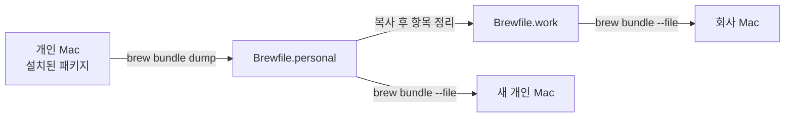

# choimory-ide-sync
여러 기기에서 사용하는 IDE들의 설정파일 관리

## 목차
- [Paseo](#paseo)
  - [동기화 대상](#동기화-대상)
  - [플러그인](#플러그인)
  - [제외 대상 (올리면 안 됨)](#제외-대상-올리면-안-됨)
  - [주의사항](#주의사항)
- [Brewfile](#brewfile)
  - [파일 구성](#파일-구성)
  - [새 기기에서 설치](#새-기기에서-설치)
  - [갱신](#갱신)
  - [Brewfile 주의사항](#brewfile-주의사항)

---

## Paseo

### 동기화 대상

| 저장소 경로 | 원본 경로 (Windows) | 내용 |
|---|---|---|
| `paseo/config.json` | `~/.paseo/config.json` | 데몬 설정 (listen 주소, MCP 주입, CORS, relay, 플러그인 활성화 `pluginsEnabled`, 에이전트 브라우저 도구 `daemon.browserTools` 등) |
| `paseo/desktop-settings.json` | `%APPDATA%/Paseo/desktop-settings.json` | 데스크톱 앱 설정 (릴리스 채널, 알림, 데몬 관리) |

`.gitignore`에서 `paseo/` 폴더는 허용 목록 방식이라 위 두 파일과 `paseo/plugins/` 외에는 추적되지 않음.

### 플러그인

| 경로 | 내용 |
|---|---|
| `paseo/plugins/sidebar-kanban` | 사이드바 **칸반(Kanban)** 메뉴. 모든 워크스페이스를 상태별(입력 대기/확인 필요/실행 중/실패/완료)로 표시 |
| `paseo/plugins/sidebar-group` | 사이드바 **그룹(Groups)** 메뉴. 워크스페이스와 에이전트 트리를 프로젝트별로 묶고, 프로젝트는 커스텀 그룹("그룹 편집") 또는 상위 디렉토리별로 묶어 표시. 커스텀 그룹은 데몬의 플러그인 설정에 저장됨(저장소에는 없음) |

두 메뉴 공통:
- 카드 클릭 → 해당 워크스페이스로 이동. 문구는 앱 언어(한국어/영어)를 따름 (`client/messages.ts`).
- 📦 버튼: 한 번 누르면 바로 보관.
- ⋮ 버튼: 사이드바 워크스페이스 메뉴와 같은 항목 (경로/브랜치 복사, 이름 변경, 상단 고정, 레이블, 파일 관리자에서 열기, 보관). "파일 관리자에서 열기"는 데스크톱 앱에서, 화면이 연결된 호스트의 워크스페이스에만 표시되며 데몬 PC에서 폴더를 엶.
- 공용 코드(`columns.ts`, `format.ts`, `archive-button.tsx`, `workspace-menu.tsx`, `shared/open-folder.ts`, `server/open-folder.ts`)는 두 플러그인에 **복사본**으로 들어 있음 → 수정 시 양쪽 모두 반영.
- 사이드바 순서는 기본적으로 플러그인 ID 알파벳순(그룹 → 칸반)인 것으로 보임. 바꾸려면 앱 **Settings → Sidebar → Header**에서 Move up/down (기기별 설정).

새 기기에서 설치 (**`config.json`을 먼저 복사한 뒤** 진행):

```bash
paseo reload   # 복사한 config.json 적용 (pluginsEnabled: true)
paseo plugin install <이 저장소 절대경로>/paseo/plugins/sidebar-kanban
paseo plugin install <이 저장소 절대경로>/paseo/plugins/sidebar-group
paseo plugin ls   # 둘 다 running 이면 OK
```

- Windows에서 `paseo`가 PATH에 없으면 `%LOCALAPPDATA%\Programs\Paseo\resources\bin\paseo.cmd` 사용.
- 플러그인은 저장소 폴더를 직접 실행하므로 `git pull` 후 `paseo plugin reload <플러그인 id>`만 하면 반영됨. `npm install`/Node 불필요 (`node_modules`는 타입체크용이라 추적 안 함).
- 타입체크(선택): 플러그인 폴더에서 `npm install -D @types/node && npm run typecheck` (서버 코드가 Node API를 써서 `@types/node` 필요. `package.json`엔 아직 없음). Node가 없으면 Paseo 내장 런타임으로도 가능: `ELECTRON_RUN_AS_NODE=1 "%LOCALAPPDATA%\Programs\Paseo\Paseo.exe" node_modules/typescript/bin/tsc --noEmit -p .`
- 문제 확인: `paseo plugin ls`(상태/에러), `paseo plugin logs <플러그인 id>`(서버 로그).

**그룹 메뉴 커스텀 그룹 백업/이전**

- 저장 위치: `~/.paseo/plugin-settings/sidebar-group/map.json`
- `paseo plugin remove`나 플러그인 ID 변경 시 **같이 삭제됨** → 미리 백업 후, 재설치하고 같은 경로(`plugin-settings/<새 id>/map.json`)에 복사한 다음 `paseo plugin reload`.
- 프로젝트 루트의 절대경로로 매칭하므로, 경로가 다른 기기에는 그대로 옮겨도 적용되지 않음 (기기마다 "그룹 편집"으로 지정).

### 제외 대상 (올리면 안 됨)

**`~/.paseo/`**

| 파일/폴더 | 이유 |
|---|---|
| `daemon-keypair.json` | 데몬 키쌍. `secretKeyB64` 비밀키 포함 (릴레이 페어링용) |
| `local-credential` | 로컬 인증 토큰 |
| `server-id`, `cli-client-id` | 기기 고유 ID. 공유 시 기기 간 충돌 |
| `paseo.pid`, `daemon.log` | 런타임 상태 / 로그 (작업 내용 포함 가능) |
| `agents/`, `agent-requests/`, `creations/`, `projects/` | 에이전트 기록, 기기별 작업공간 경로 |
| `models/`, `runtime/`, `terminal-worker/`, `desktop-attachments/`, `schedules/` | 다운로드 모델 / 런타임 / 캐시 |
| `plugin-settings/` | 플러그인별 저장 설정 (예: 그룹 메뉴 커스텀 그룹). 기기별 경로 포함 |
| `worktrees/` | 에이전트 작업용 git worktree |

**`%APPDATA%/Paseo/`**

| 파일/폴더 | 이유 |
|---|---|
| `Cache`, `Code Cache`, `GPUCache`, `Dawn*Cache` 등 | Electron 캐시 |
| `IndexedDB`, `Local Storage`, `Session Storage`, `Network`, `WebStorage` | 로그인 세션 등 민감 데이터 가능 |
| `.updaterId` | 기기 고유 ID |
| `window-state.json` | 창 위치 (기기마다 다름) |

### 주의사항
- `config.json`은 현재 비밀값이 없으나, relay 등 기능을 켜면 토큰이 추가될 수 있으므로 **커밋 전 내용 확인**.
- 플러그인을 설치하면 `~/.paseo/config.json`에 `plugins` 항목(기기별 절대경로)이 추가됨. 저장소로 옮길 때는 **`plugins` 항목을 빼고** 커밋하고, 저장소 파일을 기기에 덮어쓴 경우엔 플러그인을 다시 설치.
- `browserTools`가 켜져 있으면 에이전트가 Paseo 데스크톱 앱의 브라우저 탭(쿠키·로그인 공유)을 조작할 수 있음. 데스크톱 앱 실행 중에만 동작. 앱 **Settings → 호스트 → Agents**의 "Enable Paseo tools"도 켜져 있어야 하며, 켠 뒤 새로 연 에이전트부터 적용. 사용 예: "localhost:3000 열어서 스크린샷 찍고 콘솔 에러 확인해줘".
- 플러그인은 샌드박스 없이 실행되는 신뢰 코드 (`pluginsEnabled: true`). 직접 만든/검토한 플러그인만 설치.

---

## Brewfile

macOS Homebrew 패키지 목록. [`brew bundle`](https://docs.brew.sh/Brew-Bundle-and-Brewfile)로 설치/관리.

### 파일 구성

| 저장소 경로 | 용도 | 내용 |
|---|---|---|
| `brewfile/Brewfile.personal` | 개인 Mac | 현재 개인 Mac 전체 (`brew bundle dump` 결과 그대로) |
| `brewfile/Brewfile.work` | 회사 Mac | 개인용에서 회사에서 안 쓰는 항목을 뺀 목록 |



항목 종류:

| 키워드 | 의미 |
|---|---|
| `tap` | 서드파티 저장소 추가 (예: `codingnoye/tap` → `gksdud` 한영 전환 앱) |
| `brew` | CLI 패키지 (formula) |
| `cask` | GUI 앱 |
| `vscode` | VS Code 확장 (`visual-studio-code` cask 설치 후 적용) |
| `npm` | 전역 npm 패키지 (Node 필요) |

`Brewfile.work`에서 개인용과 다른 점:
- formula는 `git-flow`, `gradle`, `nvm`, `openjdk`만 유지 (`graphviz`, `python@3.13` 제외, `openjdk@17` → `openjdk`)
- cask에서 `cmux`, `iina`, `steam`, `spotify` 제외
- `npm "corepack"` 제외 (설치 시점에 Node가 없어 실패하므로)

### 새 기기에서 설치

파일명은 그대로 두고 `--file`로 지정.

```bash
brew bundle --file=brewfile/Brewfile.work       # 회사
brew bundle --file=brewfile/Brewfile.personal   # 개인
brew bundle check --file=brewfile/Brewfile.work # 설치 누락 확인
```

매번 `--file` 지정이 번거로우면 (선택):

```bash
# 방법 1) 환경변수 (~/.zshrc) → `brew bundle` 만으로 실행
export HOMEBREW_BUNDLE_FILE=<이 저장소 절대경로>/brewfile/Brewfile.work

# 방법 2) 홈에 심볼릭 링크 → `brew bundle --global` 로 실행 (git pull 시 바로 반영)
ln -s <이 저장소 절대경로>/brewfile/Brewfile.work ~/.Brewfile
```

설치 후 추가 설정:
- `nvm`: `mkdir ~/.nvm` 후 `~/.zshrc`에 로드 스크립트 추가 (`brew info nvm`의 Caveats 참고).
- `openjdk`: keg-only라 시스템 `java`로 자동 연결되지 않음. 터미널에서 쓰려면 `brew info openjdk`의 Caveats대로 심볼릭 링크 또는 `JAVA_HOME`/`PATH` 설정. IntelliJ에서만 쓰면 IDE에서 JDK 경로 지정.

### 갱신

```bash
# 개인 Mac: 현재 설치 상태로 덮어쓰기
brew bundle dump --force --file=brewfile/Brewfile.personal

# 회사용: dump로 덮어쓰면 정리한 내용이 사라지므로 직접 편집
```

Brewfile에 없는 패키지 정리 (주의: 삭제됨):

```bash
brew bundle cleanup --file=brewfile/Brewfile.work          # 삭제 대상 미리보기
brew bundle cleanup --force --file=brewfile/Brewfile.work  # 실제 삭제
```

### Brewfile 주의사항
- `openjdk@24`처럼 Homebrew에 없는 버전을 적으면 해당 줄에서 설치가 실패함. 사용 가능한 버전은 `brew search openjdk`로 확인.
- `gradle`은 `openjdk`(최신)에 의존하므로 버전 지정 JDK를 따로 넣어도 최신 JDK가 함께 설치됨.
- 각 항목 위의 `#` 주석은 `brew bundle dump`가 자동으로 붙인 패키지 설명.
